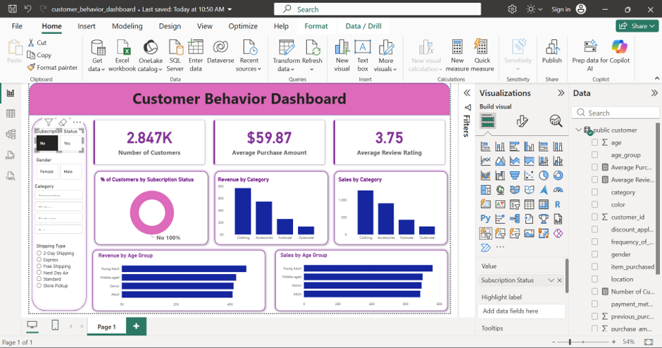
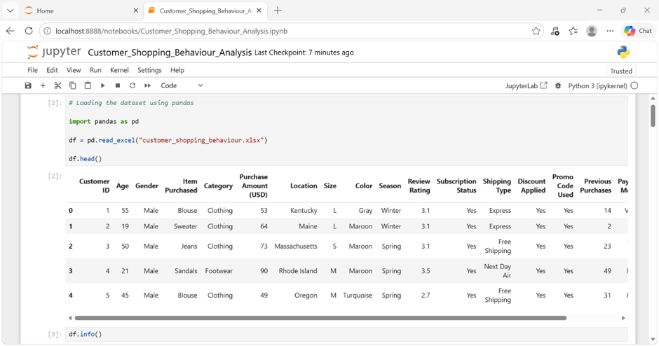
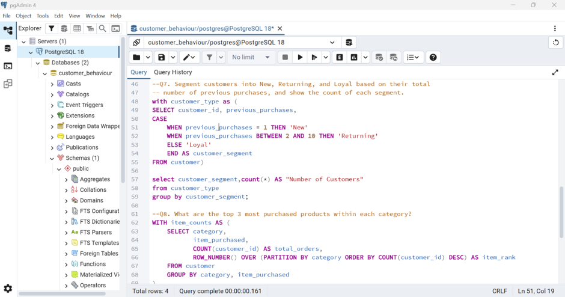

# customer_behaviour_Python_SQL_PowerBI_data_analysis

### Customer shopping behaviour analysis using Python, PostgreSQL and Power BI

An end-to-end portfolio project exploring shopping patterns, customer segments and purchasing behaviour. I prepared the data in Python, analysed it with PostgreSQL and built a Power BI dashboard to communicate the findings.



> **Dashboard context:** This screenshot has Subscription Status set to **No**. The displayed **2.847K customers**, **$59.87 average purchase amount** and **3.75 average review rating** describe the selected view, not the full dataset.

## Project purpose

The aim was to turn customer shopping data into information that could support discussions about product performance, customer engagement and purchasing patterns. The analysis explores questions such as which categories generate the most recorded purchase value, how activity differs between customer groups, and which products are purchased most often within each category.

This is a portfolio analysis of a supplied dataset, rather than evidence of results achieved for a live business.

## Tools used

| Tool | My use in this project |
| --- | --- |
| Python and pandas | Data inspection, missing-value treatment, column standardisation and feature creation |
| Jupyter Notebook | Documenting and running the preparation workflow |
| PostgreSQL and pgAdmin | Customer segmentation, grouped analysis and product ranking |
| SQLAlchemy and psycopg2 | Connecting the Python workflow to PostgreSQL |
| Power BI | KPI cards, category and age-group comparisons, and interactive filters |
| Excel | Source dataset format |

## Dataset

The source workbook contains **3,900 rows and 18 columns**, with **3,900 unique customer IDs**. It includes customer age and gender, product and category, purchase amount, location, season, review rating, subscription status, shipping type, discounts and previous purchases.

Initial checks found **37 missing review ratings**. The subscription field contains **2,847 non-subscribers** and **1,053 subscribers**.

## 1. Python data preparation

I loaded `customer_shopping_behaviour.xlsx` with pandas and inspected the first rows, data types, summary statistics and missing values.



The preparation workflow included:

- Filling missing review ratings with the median rating for the corresponding product category, then checking missing values again.
- Standardising column names, creating age and purchase-frequency features, and removing the redundant promotion field after checking it against the discount field.

### Key transformations

| Transformation | Purpose |
| --- | --- |
| Category-level median imputation | Retain records with missing review ratings using information from their product category |
| Lowercase, underscore-separated column names | Make fields easier to reference consistently in Python and SQL |
| Rename `purchase_amount_(usd)` to `purchase_amount` | Simplify the purchase-value field name |
| Create `age_group` with `pd.qcut` | Divide ages into four quantile-based groups labelled Young Adult, Adult, Middle-aged and Senior |
| Map purchase frequency to days | Create a numeric field for comparing reported purchase frequency |
| Remove `promo_code_used` | Avoid retaining two identical fields: its values matched `discount_applied` throughout the source data |

The frequency mapping uses 7 days for Weekly, 14 for Fortnightly and Bi-Weekly, 30 for Monthly, 90 for Quarterly and Every 3 Months, and 365 for Annually. These are analytical approximations, not observed purchase intervals.

## 2. PostgreSQL analysis

I used PostgreSQL and pgAdmin to explore the prepared customer data. The SQL shown below uses a common table expression and `CASE` logic to segment customers, followed by a product-ranking query using `ROW_NUMBER()` and `PARTITION BY`.



### Customer segmentation

The query applies the following project-specific definitions to `previous_purchases`:

| Segment | Rule shown in the query |
| --- | --- |
| New | Exactly 1 previous purchase |
| Returning | Between 2 and 10 previous purchases |
| Loyal | All remaining values through the `ELSE` branch |

These are analytical labels rather than validated measures of loyalty. Before reusing this logic on another dataset, zero and missing values should be handled explicitly because they would otherwise fall into the `ELSE` branch.

### Product ranking

The product query counts records by category and item, then ranks products within each category. This supports identifying the three most purchased products in each category. Each row represents a customer record in this dataset; a count of rows should not be interpreted as that customer's complete transaction history. Equal counts also require an explicit tie-breaker if a reproducible top-three ranking is needed.

## 3. Power BI dashboard

I created a dashboard bringing customer metrics and purchasing patterns into one view. It includes:

- KPI cards for customer count, average purchase amount and average review rating, with subscription, gender, category and shipping-type filters.
- Visuals comparing subscription status, purchase value and sales counts across product categories and age groups.

The dashboard allows a viewer to narrow the analysis to a selected group and compare its purchasing patterns without reading the underlying queries.

## Observations from the displayed view

With **non-subscribers selected**, Clothing has the highest displayed purchase value and sales count, followed by Accessories. Young Adult is the leading age group in the displayed purchase-value and sales charts.

These observations could inform further investigation into category preferences and engagement opportunities. They do not establish that subscription status, age or a promotion causes a change in spending. Any recommendation should be checked across other filters and against relevant business context.

## What I learned

- How to connect data preparation, relational analysis and visual reporting while keeping field definitions consistent across tools.
- How analytical choices affect interpretation, including imputed ratings, quantile-based age labels, customer segment rules and dashboard filter context.

## Limitations

The age-group names describe four groups created from this dataset's age distribution, rather than fixed demographic age bands. Imputed ratings are estimates and should not be treated as additional observed reviews. Purchase-frequency conversions simplify calendar periods, and recorded purchase values do not provide a full view of profitability or customer lifetime value.

## Repository contents

```text
customer_behaviour_Python_SQL_PowerBI_data_analysis/
|-- README.md
|-- python-data-preview.png
|-- sql-customer-segmentation.png
`-- powerbi-customer-dashboard.png
```

This repository package contains the project write-up and screenshots. The notebook, SQL script, source dataset and Power BI report are not included in this package, so it is a visual case study rather than a fully reproducible release.

## Author

**Joan Mancilla Cetre**  
[GitHub portfolio](https://github.com/JMC221) | [LinkedIn](https://www.linkedin.com/in/joan-mancilla-cetre-93b280199/)
